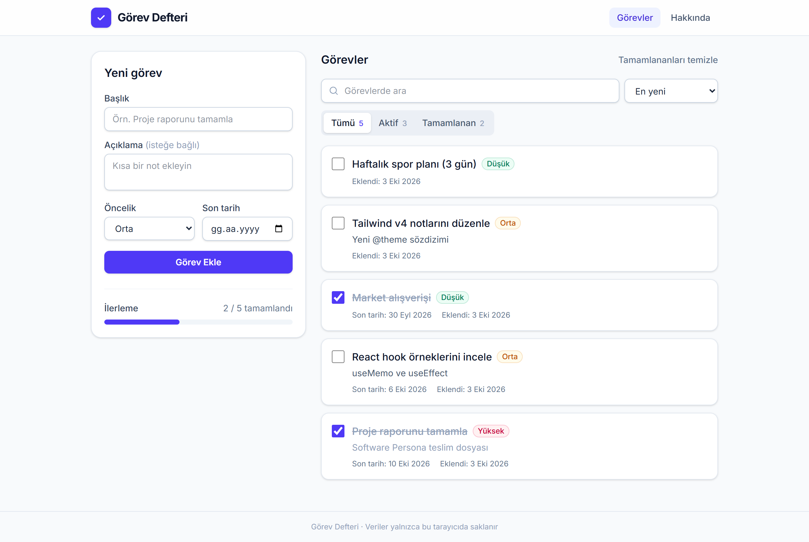
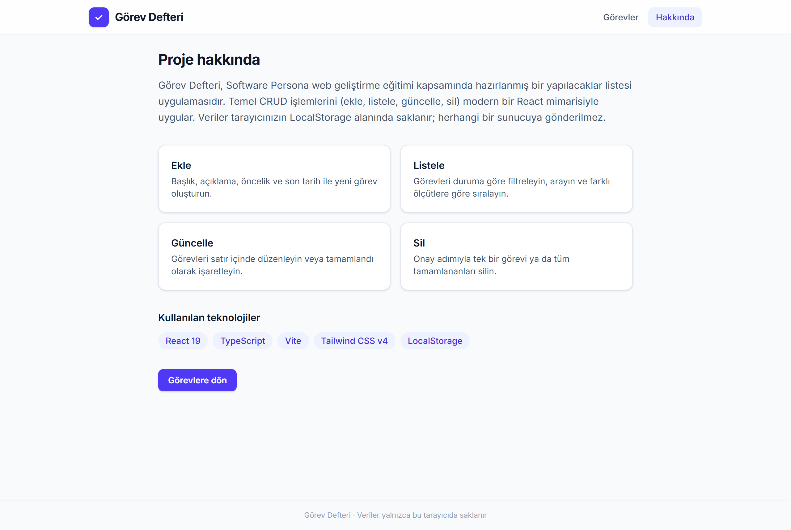
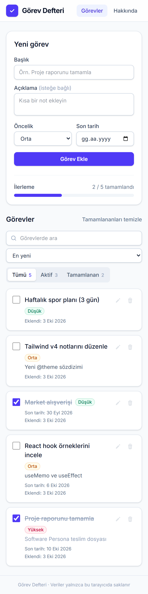

# Görev Defteri

Software Persona **Web Geliştirme** eğitimi proje yönergesi kapsamında geliştirilmiş, React tabanlı bir yapılacaklar (TODO) uygulaması.

**Canlı demo:** https://yusa.app/sp-web-app/



## Özellikler

| İşlem | Açıklama |
| --- | --- |
| **Ekle** | Başlık, açıklama, öncelik (düşük / orta / yüksek) ve son tarih ile görev oluşturma; boş başlık doğrulaması |
| **Listele** | Tümü / Aktif / Tamamlanan filtreleri, metin araması, yeni-eski / öncelik / son tarih sıralaması |
| **Güncelle** | Satır içi düzenleme formu ve tek tıkla tamamlandı olarak işaretleme |
| **Sil** | Onay adımı ile tek görev silme, tamamlananları toplu temizleme |

Ek olarak:

- Veriler tarayıcının **LocalStorage** alanında saklanır, sayfa yenilendiğinde kaybolmaz.
- Son tarihi geçmiş görevler "Gecikti" olarak vurgulanır.
- İlerleme çubuğu ile tamamlanma oranı gösterilir.
- Mobil uyumlu (responsive) arayüz.

## Kullanılan teknolojiler

- [React 19](https://react.dev/) + [TypeScript](https://www.typescriptlang.org/)
- [Vite](https://vite.dev/)
- [Tailwind CSS v4](https://tailwindcss.com/)

## Proje yapısı

```
src/
├── Components/     # Yeniden kullanılabilir arayüz bileşenleri
│   ├── Header.tsx
│   ├── PriorityBadge.tsx
│   ├── TaskFilters.tsx
│   ├── TaskForm.tsx
│   ├── TaskItem.tsx
│   ├── TaskList.tsx
│   └── TaskStats.tsx
├── Interfaces/     # TypeScript tip ve arayüz tanımları
│   ├── Page.ts
│   └── Task.ts
├── Pages/          # Sayfa bileşenleri
│   ├── AboutPage.tsx
│   └── TasksPage.tsx
├── hooks/          # Özel React hook'ları
│   ├── useHashRoute.ts
│   ├── useLocalStorage.ts
│   └── useTasks.ts
├── App.tsx
├── index.css
└── main.tsx
```

## Kurulum

```bash
git clone https://github.com/yushadev0/sp-web-app.git
cd sp-web-app
npm install
npm run dev
```

Uygulama `http://localhost:5173/sp-web-app/` adresinde açılır.

| Komut | Açıklama |
| --- | --- |
| `npm run dev` | Geliştirme sunucusunu başlatır |
| `npm run build` | Tip kontrolü yapar ve `dist/` klasörüne üretim derlemesi alır |
| `npm run preview` | Üretim derlemesini yerelde önizler |
| `npm run lint` | Kodu oxlint ile denetler |

## Yayına alma

Uygulama `vite.config.ts` içindeki `base: '/sp-web-app/'` ayarıyla alt dizinde çalışacak şekilde derlenir. `npm run build` çıktısı (`dist/`) sunucuda nginx tarafından statik olarak sunulur. Sayfa geçişleri hash tabanlı (`#/about`) olduğundan sunucuda ek yönlendirme kuralı gerekmez.

## Ekran görüntüleri

| Hakkında | Mobil |
| --- | --- |
|  |  |
